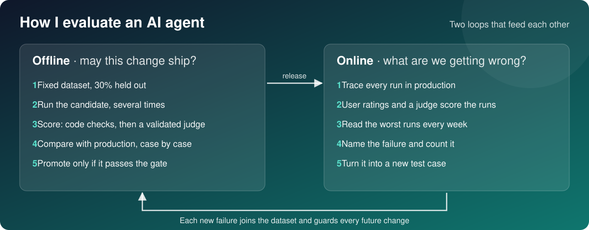

# AI Evals Method

How I measure, improve and ship an AI agent: two loops, fifteen steps and one release gate.

The method works with any tool. I run it with Arize AX for traces, datasets, experiments, judges and prompt versions, and with Claude Code skills for the analysis. Every example uses a fictional product and fictional data.

**One rule holds the two loops together:** read real traces before you write any automated check. A judge built on guesses only measures the guesses.

## The workflow

### Before production

| # | Step | What you do | Done when |
|---|---|---|---|
| 1 | Trace every run | Record the input, the model call, the output and any validator correction. Tag each run with its prompt version. | Every run is visible and tagged |
| 2 | Check trace health | Check that spans connect, carry input and output, and count tokens. | No orphan or empty spans |
| 3 | Read traces, name failures | Label 30 to 50 traces Pass or Fail. Write one sentence on the first thing that went wrong. Group the notes. | 4 to 6 named failure modes, each with a count |
| 4 | Code checks first | Put format, required facts, quotes and forbidden values in code. | Every objective rule runs in code |
| 5 | Build the dataset | Fix a set of cases with expected outcomes. Hold out 30% that you never tune on. | Enough cases to support a claim |
| 6 | Run experiments | Run each version on the same dataset, several times. | You see which cases a change fixed or broke |
| 7 | Add one judge, then validate it | Write one LLM judge per failure mode that code cannot check. | Its scores agree with human labels |
| 8 | Version the prompt | Keep immutable versions and a movable `production` label. | Rolling back means moving a label |
| 9 | Optimize from failures | Ask for the smallest prompt change that fixes the pattern, without copying test data. | The gain holds on held-out cases |
| 10 | Pass the gate | Apply the release gate below. | Promote, or go back a step |

### In production

| # | Step | What you do |
|---|---|---|
| 11 | Trace in the app | The same tracing, with personal data hidden when real customers are involved. |
| 12 | Link user ratings to traces | Each thumbs-down points to the exact run to read. |
| 13 | Judge a sample of new runs | Start at 20 to 30% of runs, after the judge is validated. |
| 14 | Dashboard and alerts | Track pass rate, ratings, cost and latency per prompt version and model. |
| 15 | Weekly review | Thirty minutes. Read the worst runs and turn each new failure into a dataset case. |

## The release gate

A change ships only when all six hold:

- [ ] Code checks pass on the full dataset, in 3 runs per model.
- [ ] No regression: every case that passes today still passes.
- [ ] Held-out cases pass at least as well as before.
- [ ] The judge is validated and finds no failure.
- [ ] Cost and latency stay inside the budget in the PRD.
- [ ] A person reads 10 new outputs.

## What "100% accuracy" can mean

| Kind | What it is | Can it be guaranteed? |
|---|---|---|
| By construction | A rule enforced in code, such as a quote that must appear on the line it cites | Yes, on every run |
| On the eval set | A gate the prompt must clear in repeated runs | Only for those cases |
| In production | A rate measured on real runs | No. Zero failures in *n* cases still allows a failure rate up to about 3/*n* (the rule of three, 95% confidence) |

To claim 95% accuracy you need about 60 clean cases. For 99%, about 300. The last check is a person: every write to the system of record is approved by a person, or allowed by a rule that person set.

## Lessons from running it

- **One run proves little.** On a smaller model, failures moved from case to case between runs. Only a failure that repeats is a failure mode. The rest is noise.
- **The gate catches good-looking changes.** A schema change that looked like a pure improvement dropped the pass rate from 11 of 11 to 8 of 11. It did not ship.
- **Code checks and judges catch different failures.** Code checks catch missing facts. A judge catches invented ones.
- **A judge that never says Fail cannot be measured.** Its numbers stay off any gate until it agrees with human labels.
- **Optimizing on the eval set inflates the gain.** A tuned prompt went from 16 to 21 of 22 checks. It stays a candidate until held-out cases confirm it.

## Read next

- [How to write an LLM-as-a-Judge](docs/llm-as-a-judge.md): the method, and how a PM should steer it.
- [Example judge prompt](examples/evidence-supported-judge.md): one judge, one failure mode, ready to adapt.

## Sources

The method builds on the AI evals course by Hamel Husain and Shreya Shankar, the AI Product Management program at Product Faculty, and the Arize AX documentation.
